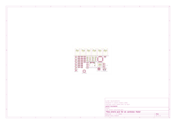

# PEXADRONE (PARAM + HEXADRONE)

(under early stage development)

open source drone printed circuit board design with 6 coreless motors,  
using [stm32f030c8t6](https://www.st.com/content/st_com/en/products/microcontrollers-microprocessors/stm32-32-bit-arm-cortex-mcus/stm32-mainstream-mcus/stm32f0-series/stm32f0x0-value-line/stm32f030c8.html) microcontroller chip for processing data and motor control,  
and [nrf24l01+](https://www.nordicsemi.com/Products/nRF24-series) 2.4Ghz radio transciever chip for wireless communication.

# LICENSE

Licensed under CERN Open Hardware Licence Version 2 - Weakly Reciprocal  
check "LICENSE" file for the license

# Images

There are 3d model files available in the 3dModels folder, in both stl and glb file formats.


Pcb manufacturing files (gerbers) are exported into the **exports** folder

(schematic and the copper routing)'s PDF files are available in the **PDFs** folder

> Note:
> The "makefile" can be used by typing ```make``` in the project root directory, to automatically update the images, PDFs, 3d models and exports as the kicad files change.  
> The makefile uses kicad-cli to generate the resources.

[3d model (stl)](3dModels/drone-pcb.stl)


[Schematics (click on this link to see the PDF)](PDFs/drone-pcb-schematic.pdf)


[Pcb routing (click on this link to see the PDF)](PDFs/drone-pcb-board.pdf)

