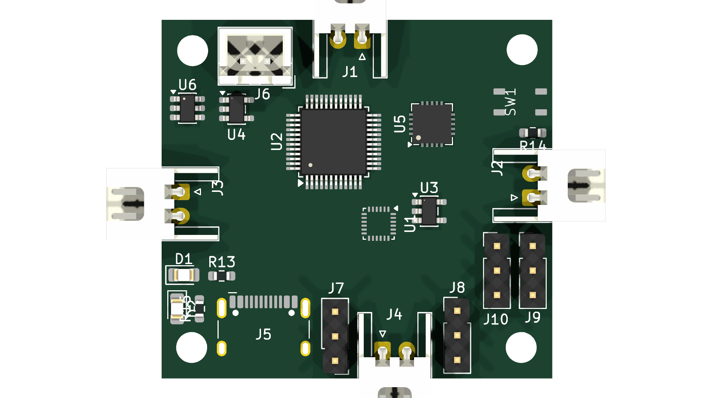
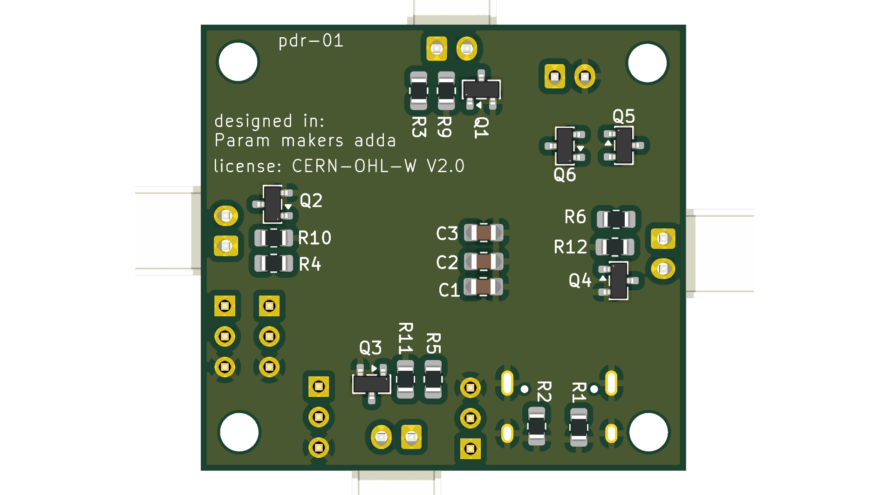
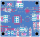

# SNI drone (Stm32 + Nrf24l01+ + Imu drone)

(under early stage development)

open source drone printed circuit board design with 4 coreless motors,  
using [stm32f103c8](https://www.st.com/en/microcontrollers-microprocessors/stm32f103c8.html) microcontroller chip for processing data and motor control,  
and [nrf24l01+](https://www.nordicsemi.com/Products/nRF24-series) 2.4Ghz radio transciever chip for wireless communication.

# LICENSE

Licensed under CERN Open Hardware Licence Version 2 - Weakly Reciprocal  
check "LICENSE" file for the license

# Images

There are 3d model files available in the 3dModels folder, in both stl and glb file formats.

Pcb manufacturing files (gerbers) are exported into the **exports** folder

(schematic and the copper routing)'s PDF files are available in the **PDFs** folder

[3d model (stl)](3dModels/drone-pcb.stl)  

front  

back  

[Schematics (click on this link to see the PDF)](PDFs/drone-pcb.pdf)

[Pcb routing (click on this link to see the PDF)](PDFs/drone-pcb-B_Cu.pdf)  

