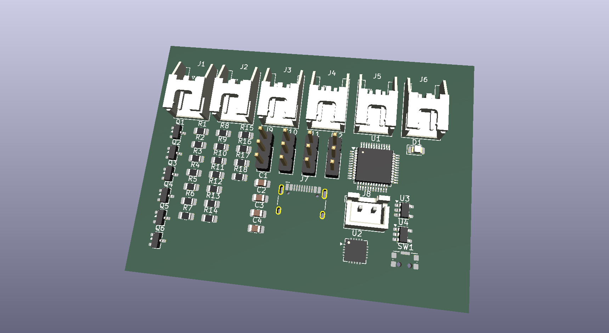
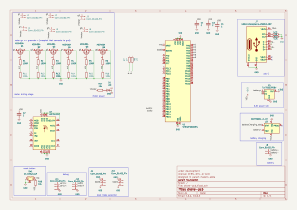
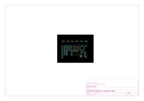

# PEXADRONE (PARAM + HEXADRONE)

(under early stage development)

open source drone with 6 coreless motors, using stm32f030c8t6 chip, and nrf24l01+ for radio

# LICENSE

Licensed under CERN Open Hardware Licence Version 2 - Weakly Reciprocal

check "LICENSE" file for the license

# images

[3d model](3dModels/drone-pcb.stl)

[schematic](PDFs/drone-pcb-schematic.pdf)

[pcb routing](PDFs/drone-pcb-board.pdf)

