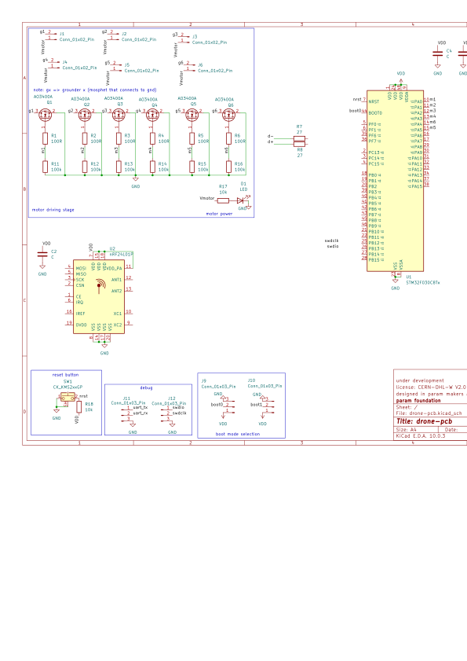

# PEXADRONE (PARAM + HEXADRONE)

(under early stage development)

open source drone with 6 coreless motors, using stm32f030c8t6 chip, and nrf24l01+ for radio

# LICENSE

Licensed under CERN Open Hardware Licence Version 2 - Weakly Reciprocal
check "LICENSE" file for the license

# images

